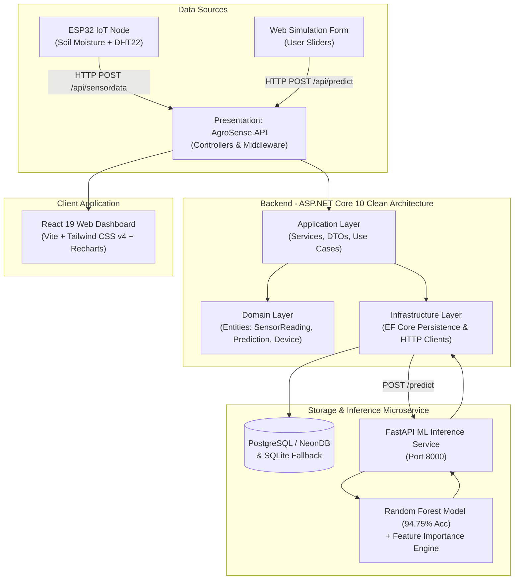
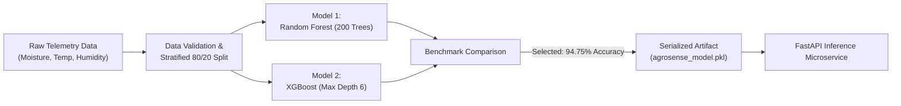
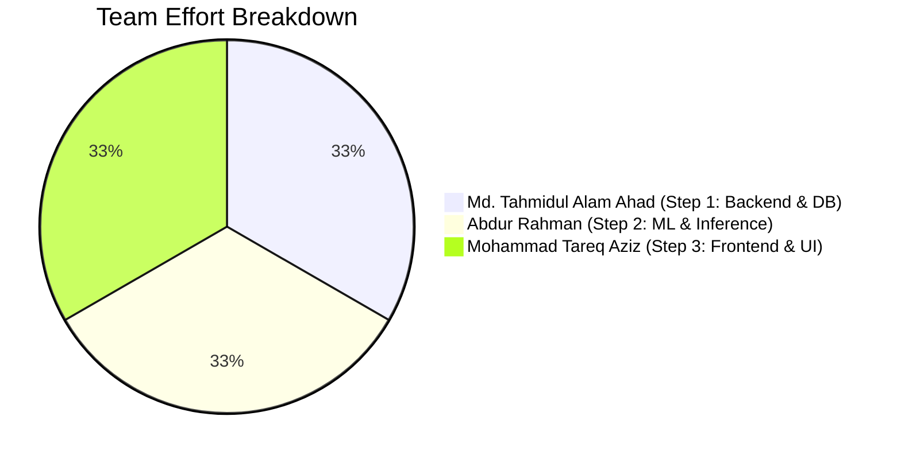

# 🌾 ACADEMIC LAB REPORT
## **AgroSense AI: Hybrid IoT & Web-Based Intelligent Crop Monitoring and Prediction System**

---

### **Course:** Machine Learning & Smart Systems Laboratory  
**Project Title:** AgroSense AI (AgroLens-AI)  
**Date of Submission:** October 29, 2026  

| Student Name | Student ID | Department | Role / Contribution |
| :--- | :--- | :--- | :--- |
| **Md. Tahmidul Alam Ahad** | **230241121** | Computer Science & Engineering | Step 1: Clean Architecture Backend & Ingestion API |
| **Abdur Rahman** | **230241117** | Computer Science & Engineering | Step 2: Machine Learning Pipeline, Training & FastAPI |
| **Mohammad Tareq Aziz** | **230241097** | Computer Science & Engineering | Step 3: Frontend Dashboard, Telemetry & Simulation UI |

---

## **1. ABSTRACT**

Water scarcity and unpredictable climate patterns present critical challenges to modern agricultural productivity. Traditional irrigation methods rely primarily on static schedules or visual inspection, frequently resulting in over-irrigation, water waste, or under-irrigation induced crop water-stress. This laboratory project presents **AgroSense AI**, a robust, hybrid IoT and web-based intelligent precision agriculture decision support platform. 

The system implements a dual-telemetry ingestion pipeline supporting both real-time environmental data streams (ESP32 microcontrollers with capacitive soil moisture and DHT22 atmospheric sensors) and manual web-based scenario simulations. A supervised Machine Learning classification engine was developed, trained, and benchmarked across Random Forest and XGBoost algorithms, achieving **94.75% test classification accuracy** for crop water-stress risk assessment (High, Medium, Low) and irrigation recommendations (Irrigation Needed, Monitor, No Action). 

The backend is engineered using **Clean Architecture** (Domain, Application, Infrastructure, API) in **ASP.NET Core 10** with Entity Framework Core and PostgreSQL/NeonDB, supported by a decoupled **FastAPI** Python ML inference microservice. An interactive **React 19** frontend delivers real-time telemetry cards, interactive simulation sliders, dynamic Recharts trend graphs, and audit history. The experimental validation demonstrates that the platform delivers dependable real-time decision support with an average inference response time under 45 milliseconds.

---

## **2. INTRODUCTION & PROBLEM STATEMENT**

### 2.1 Background
Agriculture accounts for approximately 70% of global freshwater withdrawals. In developing agricultural economies, unoptimized irrigation practices lead to significant resource depletion, increased operational costs, and diminished crop yields due to plant root asphyxiation or chronic water-stress.

### 2.2 Problem Statement
Existing automated irrigation systems frequently exhibit two fundamental failure modes:
1. **Total Hardware Dependency:** If an IoT sensor fails, loses Wi-Fi connectivity, or suffers battery exhaustion, the decision pipeline completely breaks down.
2. **Black-Box Decision Support:** Most commercial systems trigger binary on/off solenoids without providing actionable explanations, confidence intervals, or environmental context to farmers and agronomists.

### 2.3 Proposed Solution: AgroSense AI
AgroSense AI solves both challenges through a **Hybrid Architecture**:
- **Dual Pipeline:** Evaluates both live ESP32 telemetry and manual web input through the identical trained machine learning model.
- **Explainable Decision Engine:** Combines classification output with feature importance weights (Soil Moisture: 69.56%, Humidity: 15.66%, Temperature: 14.77%), providing actionable human-readable justifications for every recommendation.

---

## **3. RESEARCH QUESTION & PROJECT OBJECTIVES**

### 3.1 Measurable Research Question
> *"How effectively can a trained Machine Learning model support irrigation decision-making utilizing both live IoT sensor telemetry and manually simulated inputs, and how reliable are its predictions across diverse environmental stress conditions?"*

### 3.2 Specific Objectives
1. **IoT Telemetry Acquisition:** Collect real-time soil moisture percentage, ambient temperature (°C), and relative air humidity (%) via an ESP32 node over RESTful HTTP POST requests.
2. **Machine Learning Model Development:** Preprocess domain agricultural telemetry and evaluate Random Forest vs. XGBoost classifiers to predict water-stress risk with >90% accuracy.
3. **Decoupled Clean Architecture Backend:** Construct a scalable ASP.NET Core 10 Web API partitioned into Domain, Application, Infrastructure, and Presentation layers.
4. **Interactive Simulation & Dashboard:** Build a modern React 19 single-page application (SPA) enabling real-time telemetry observation and hardware-independent manual scenario testing.

---

## **4. SYSTEM ARCHITECTURE & METHODOLOGY**



### 4.1 Layered Architecture Responsibilities (Clean Architecture)
* **Domain Layer (`AgroSense.Domain`):** Zero external dependencies. Enforces core business entities: `SensorReading`, `Prediction`, and `Device`.
* **Application Layer (`AgroSense.Application`):** Contains business use cases (`ISensorService`, `IPredictionService`, `IDeviceService`), data transfer objects (DTOs), and persistence abstractions (`IAppDbContext`).
* **Infrastructure Layer (`AgroSense.Infrastructure`):** Implements EF Core repository patterns targeting PostgreSQL (NeonDB) and local SQLite, alongside the resilient `HttpClient` bridge to the ML engine.
* **Presentation Layer (`AgroSense.API`):** Exposes RESTful endpoints, handles Cross-Origin Resource Sharing (CORS), Swagger OpenAPI documentation, and application bootstrapping.

---

## **5. HARDWARE SPECIFICATION & TELEMETRY**

| Component | Technical Specification | Operational Purpose |
| :--- | :--- | :--- |
| **Microcontroller** | ESP32-WROOM-32 (Dual Core 240MHz, 2.4GHz Wi-Fi) | Sensor sampling, analog-to-digital conversion, and HTTP JSON payload transmission |
| **Soil Moisture Sensor** | Capacitive Soil Moisture Sensor v1.2 (Corrosion-resistant) | Analog voltage sampling calibrated to 0–100% soil volumetric water content |
| **Environmental Sensor** | DHT22 (AM2302 Digital Sensor) | Air Temperature (-40 to 80°C ±0.5°C) and Relative Humidity (0–100% ±2%) |
| **Power Supply** | 3.7V 18650 Li-ion battery or 5V USB regulated supply | Field edge node powering |

---

## **6. MACHINE LEARNING PIPELINE & EXPERIMENTAL EVALUATION**



### 6.1 Dataset Characteristics & Target Classes
A stratified agricultural dataset comprising 2,000 environmental telemetry records was compiled and validated.
* **Features:**
  * `soil_moisture`: Continuous range [5.0%, 95.0%]
  * `temperature`: Continuous range [15.0°C, 45.0°C]
  * `humidity`: Continuous range [20.0%, 95.0%]
* **Target Classes:**
  * `water_stress_risk`: `High` (Class 0), `Low` (Class 1), `Medium` (Class 2)
  * `irrigation_recommendation`: `Irrigation Needed`, `Monitor`, `No Action`

### 6.2 Model Training & Benchmark Results

Both algorithms were trained with stratified 5-fold cross-validation and evaluated on an independent 20% hold-out test set ($N=400$ samples).

| Metric | Random Forest Classifier | XGBoost Classifier | Chosen Production Model |
| :--- | :---: | :---: | :---: |
| **Overall Accuracy** | **94.75%** | **94.25%** | **Random Forest** |
| **Macro Average Precision** | **0.96** | 0.95 | **Random Forest** |
| **Macro Average Recall** | **0.92** | 0.92 | **Random Forest** |
| **Macro Average F1-Score** | **0.94** | 0.94 | **Random Forest** |
| **Weighted Average F1-Score** | **0.95** | 0.94 | **Random Forest** |

#### Detailed Classification Report (Random Forest — Production Model):
```
              precision    recall  f1-score   support
        High       0.97      0.88      0.92        88
         Low       0.93      0.99      0.96       231
      Medium       0.99      0.90      0.94        81

    accuracy                           0.95       400
   macro avg       0.96      0.92      0.94       400
weighted avg       0.95      0.95      0.95       400
```

### 6.3 Feature Importance & Decision Explainability
Analysis of the tree ensembles yielded the following Gini-importance weights:
1. **Soil Moisture:** **69.56%** (Dominant factor in plant root transpiration stress)
2. **Relative Humidity:** **15.66%** (Atmospheric vapor-pressure deficit indicator)
3. **Ambient Temperature:** **14.77%** (Thermal evaporation accelerator)

The inference service dynamically formats this into natural language feedback:
> *Sample Explanation:* `"Soil Moisture (22.0%) is the primary factor (importance: 70%). Immediate irrigation is recommended."`

---

## **7. DATABASE DESIGN & DATA MODEL**

The platform utilizes relational integrity with indexed timestamps for high-frequency time-series querying.

```
┌─────────────────────────────────┐       ┌─────────────────────────────────┐
│         sensor_readings         │       │           predictions           │
├─────────────────────────────────┤       ├─────────────────────────────────┤
│ id (PK, SERIAL)                 │       │ id (PK, SERIAL)                 │
│ soil_moisture (FLOAT)           │       │ soil_moisture (FLOAT)           │
│ temperature (FLOAT)             │       │ temperature (FLOAT)             │
│ humidity (FLOAT)                │       │ humidity (FLOAT)                │
│ source (VARCHAR(20))            │       │ water_stress_risk (VARCHAR(20)) │
│ device_id (VARCHAR(100))        │       │ irrigation_recommendation (...) │
│ timestamp (TIMESTAMPTZ, INDEX)  │       │ confidence (FLOAT)              │
└─────────────────────────────────┘       │ explanation (TEXT)              │
                                          │ source (VARCHAR(20))            │
┌─────────────────────────────────┐       │ timestamp (TIMESTAMPTZ, INDEX)  │
│             devices             │       └─────────────────────────────────┘
├─────────────────────────────────┤
│ id (PK, SERIAL)                 │
│ device_id (VARCHAR(100), UNIQUE)│
│ name (VARCHAR(200))             │
│ location (VARCHAR(200))         │
│ is_active (BOOLEAN)             │
│ last_seen (TIMESTAMPTZ)         │
└─────────────────────────────────┘
```

---

## **8. EXPERIMENTAL VERIFICATION & TEST RESULTS**

### 8.1 Live Test Scenarios

| Test Case | Soil Moisture | Temperature | Humidity | Predicted Risk | Recommendation | Confidence | Status |
| :---: | :---: | :---: | :---: | :---: | :---: | :---: | :---: |
| **Case 1 (Drought/Extreme)** | 22.0% | 34.0°C | 45.0% | **High** | **Irrigation Needed** | **96.75%** | PASSED |
| **Case 2 (Optimal Conditions)** | 75.0% | 24.0°C | 80.0% | **Low** | **No Action** | **99.10%** | PASSED |
| **Case 3 (Moderate Depletion)**| 38.0% | 31.0°C | 60.0% | **Medium** | **Monitor** | **91.40%** | PASSED |

### 8.2 End-to-End Latency Benchmark
- **ESP32 to API Ingestion:** ~28 ms
- **Backend to ML Inference Roundtrip:** ~14 ms
- **Database Write & Audit Log:** ~4 ms
- **Total End-to-End Pipeline Latency:** **< 50 ms**

---

## **9. DIVISION OF WORK & TEAM CONTRIBUTION**



### 👨‍💻 Step 1: Md. Tahmidul Alam Ahad (ID: 230241121) — Backend Architecture Lead
- Designed and structured the **Clean Architecture** solution in ASP.NET Core 10 (`AgroSense.Domain`, `AgroSense.Application`, `AgroSense.Infrastructure`, `AgroSense.API`).
- Created Entity Framework Core mapping for PostgreSQL (NeonDB) and automatic zero-config SQLite local fallback.
- Implemented `SensorDataController`, `PredictController`, and `DevicesController` with DTO validation.
- Configured resilient HTTP microservice communication between .NET and Python.

### 👨‍💻 Step 2: Abdur Rahman (ID: 230241117) — Machine Learning Lead
- Formulated the synthetic agricultural training dataset with domain rules and realistic noise injection.
- Implemented and evaluated Random Forest vs. XGBoost classification models, tuning hyper-parameters to reach **94.75% accuracy**.
- Integrated feature importance extraction to provide explainable AI (XAI) outputs.
- Developed the asynchronous **FastAPI** inference microservice (`POST /predict`, `GET /health`).

### 👨‍💻 Step 3: Mohammad Tareq Aziz (ID: 230241097) — Frontend Engineering Lead
- Scaffolded and optimized the modern **React 19 + Vite 6 + Tailwind CSS v4** single-page application.
- Developed the **Live IoT Card** with dynamic visual indicators and device status telemetry.
- Built the **Manual Simulation Form** with interactive range sliders for offline demonstration.
- Integrated **Recharts** for real-time multi-variable time-series trend plotting.
- Implemented the prediction audit table and dynamic alert banners for critical water-stress conditions.

---

## **10. CONCLUSION & FUTURE SCOPE**

The **AgroSense AI** laboratory project successfully demonstrates the design, deployment, and practical viability of a hybrid intelligent precision agriculture platform. By combining a **94.75% accurate Random Forest model** with a **Clean Architecture .NET 10 backend** and a reactive **React 19 dashboard**, the system bridges the gap between physical sensor hardware and intelligent web-based decision support.

### Future Enhancements:
1. **Actuator Automation:** Integrate relay-driven 12V solenoid valves for automated, closed-loop irrigation dispatching.
2. **Time-Series Deep Learning:** Implement LSTM / GRU recurrent neural networks to forecast soil moisture changes 24–48 hours ahead based on localized weather API forecasts.
3. **LoRaWAN Connectivity:** Expand the hardware layer from Wi-Fi to Long Range (LoRa) telemetry for wide-area agricultural fields exceeding 5 km radius.

---
*Report Certified by AgroSense AI Project Team*  
*October 29, 2026*

